  

  

### `> about_me.txt`

- Software Engineering student @ **UNDB**, São Luís (MA), Brazil
- Currently focused on **front-end** and building web applications
- Interested in web development, software architecture built on modern technologies, and creative, intuitive and efficient interfaces
- Hands-on experience from personal projects, academic work and innovation challenges with local industry
- **Tech:** Python · React · JavaScript · HTML · CSS
- **Languages:** Portuguese (native) · English (advanced)

🇧🇷 <b>Sobre mim (PT-BR)</b>

 

- Estudante de Engenharia de Software na **UNDB**, em São Luís (MA)
- Foco atual em **front-end** e construção de aplicações web
- Interesse em desenvolvimento web, arquitetura de software com tecnologias modernas e interfaces criativas, intuitivas e eficientes
- Experiência prática em projetos pessoais, acadêmicos e desafios de inovação com a indústria local
- **Tecnologias:** Python · React · JavaScript · HTML · CSS
- **Idiomas:** português (nativo) · inglês (avançado)

### `> tools.dll`

  

<h4 align="center">Languages</h4>

  

<h4 align="center">Frontend</h4>

  

<h4 align="center">Backend & Data</h4>

  

<h4 align="center">Tools</h4>

  
  
  
  

### `> stats.log`

  
  

  

### `> contact.lnk`

  
  

  

